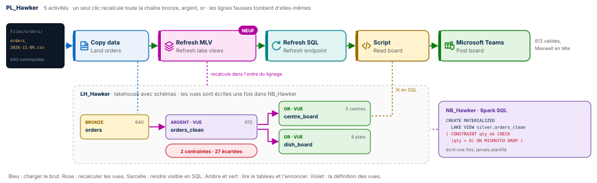
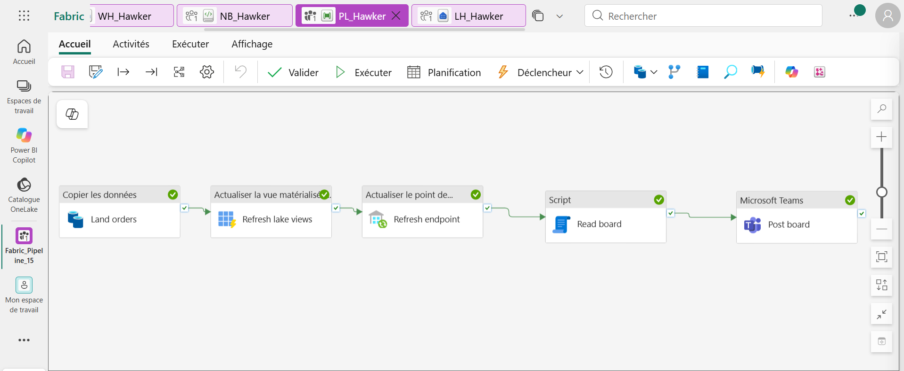
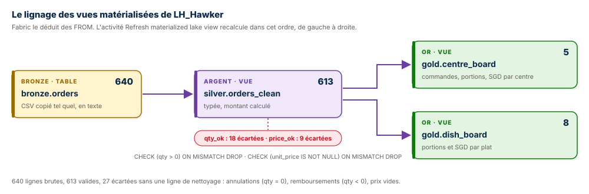
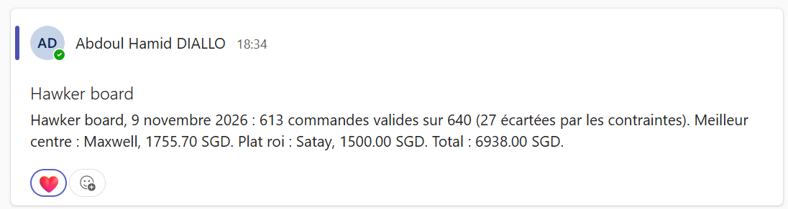
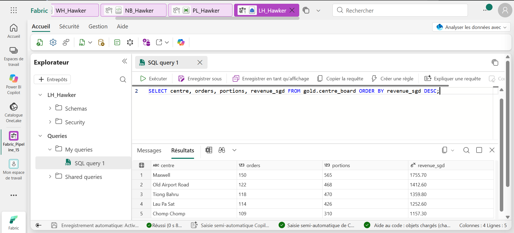
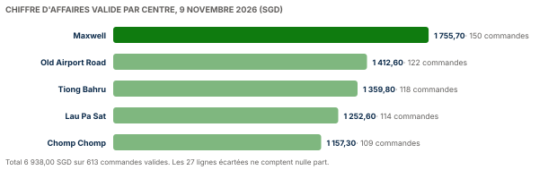

# 🍜 Fabric Pipeline Express 15 : des vues qui se nettoient seules




Un pipeline Microsoft Fabric Data Factory qui transforme la journée de cinq hawker centres de Singapour en tableau de bord, sans une ligne de nettoyage dans le pipeline. Les 640 commandes du 9 novembre 2026 arrivent brutes, avec 27 lignes fausses : assiettes annulées, remboursements, prix oubliés. Trois **vues matérialisées du lac** (materialized lake views), écrites une seule fois en Spark SQL, portent toute la logique : la vue argent type les colonnes et **écarte les lignes fausses par deux contraintes**, les deux vues or font les totaux. Dans le pipeline, **une seule activité recalcule toute la chaîne**, dans l'ordre que Fabric déduit seul du lignage. Le tableau du jour part ensuite dans Teams.

**Guide PDF de 7 pages inclus** : [`Pipeline_Fabric_Guide_15_public.pdf`](Pipeline_Fabric_Guide_15_public.pdf). Chaque écran, chaque réglage, chaque cellule, et les chiffres à retrouver à l'unité près. Les valeurs à copier sont dans [`data/expressions.txt`](data/expressions.txt) et les requêtes commentées dans [`sql/`](sql).

## 📸 Aperçu

`PL_Hawker` après une exécution réussie : charger le brut, recalculer les vues, rendre visible en SQL, lire le tableau, l'annoncer.



Le lignage des vues : Fabric le lit dans les `FROM`, et l'activité Refresh materialized lake view le suit de gauche à droite.



Le message publié dans Microsoft Teams, construit entièrement en SQL.



La requête de contrôle sur le point de terminaison SQL du lakehouse : la vue or `gold.centre_board`.



## 🎯 Résultats clés

| Indicateur | Valeur |
|---|---|
| Activités | 5 (Copy data, Refresh materialized lake view, Refresh SQL analytics endpoint, Script, Microsoft Teams) |
| Nouveautés | Activité Refresh materialized lake view, vues matérialisées du lac en Spark SQL, contraintes `ON MISMATCH DROP`, lignage calculé par Fabric, lakehouse à schémas bronze, argent, or |
| Commandes brutes | 640, dans cinq hawker centres |
| Commandes valides | 613 |
| Lignes écartées | 27 : 18 par `qty_ok` (annulations et remboursements), 9 par `price_ok` (prix vides) |
| Meilleur centre | Maxwell, 1 755,70 SGD sur 150 commandes |
| Plat roi | Satay, 1 500,00 SGD pour 1 250 brochettes |
| Chiffre d'affaires valide | 6 938,00 SGD |
| Lignes de nettoyage écrites | 0 |

## 💼 Impact métier

Un chiffre d'affaires calculé sur des données sales est un chiffre faux, et personne ne le voit. Sommer le brut de cette journée donne 6 866,60 SGD : les remboursements sont soustraits, les prix vides ignorés, et le total ne correspond à rien. Ici, la règle « une commande valide a une quantité positive et un prix » est écrite une fois, dans la définition de la vue, à côté des données qu'elle protège. Elle s'applique à chaque recalcul, sans dépendre d'un développeur qui pense à ajouter un `WHERE`. Ajouter une vue or demain ne demande aucun changement dans le pipeline : l'activité recalcule tout ce que le lakehouse contient.

## 📝 Résumé

`PL_Hawker` copie le CSV du jour, tel quel et en texte, dans la table `bronze.orders` du lakehouse `LH_Hawker`. L'activité `Refresh lake views` recalcule alors les vues matérialisées du lakehouse : `silver.orders_clean` d'abord, qui type les colonnes, calcule le montant et écarte les 27 lignes fausses par ses contraintes, puis `gold.centre_board` et `gold.dish_board`, qui totalisent par centre et par plat. `Refresh endpoint` rend ces vues visibles tout de suite en SQL. Le Script `Read board`, sur l'entrepôt `WH_Hawker`, les lit par des noms en trois parties et renvoie une ligne de chiffres, avec la phrase complète `msg`. `Post board` l'annonce dans Teams.

## 🔁 Pipeline

| Activité | Type | Rôle |
|---|---|---|
| `Land orders` | Copy data | Le CSV du jour vers `bronze.orders`, action Remplacer |
| `Refresh lake views` | Refresh materialized lake view | Recalcule toutes les vues du lakehouse, dans l'ordre du lignage |
| `Refresh endpoint` | Refresh SQL analytics endpoint | Rend les vues à jour visibles en SQL sans attente |
| `Read board` | Script | Brut, valide, meilleur centre, plat roi, total et le message `msg` |
| `Post board` | Microsoft Teams | Publie `msg` avec `@{activity('Read board').output.resultSets[0].rows[0].msg}` |

## 🧠 Les quatre idées du projet

**La logique vit dans les vues, pas dans le pipeline.** Le pipeline ne fait qu'un geste : « recalcule ». Ce qui est calculé, et comment, est déclaré une fois dans trois `CREATE MATERIALIZED LAKE VIEW`.

**Des contraintes qui nettoient.** `CHECK (qty > 0) ON MISMATCH DROP` écarte toute ligne qui ne passe pas, sans faire échouer le recalcul. Avec `FAIL` au lieu de `DROP`, le même contrôle deviendrait un garde-fou bloquant.

**Un lignage que personne n'écrit.** Fabric lit les `FROM` des vues et en déduit l'ordre : l'argent avant l'or. La page de gestion des vues dessine ce lignage et garde l'historique des recalculs.

**Le message fabriqué en SQL.** `Read board` construit la phrase Teams avec `CONCAT`. L'activité Teams n'affiche qu'une valeur, `@{…msg}` : moins d'expressions, moins de points de rupture.

## 🚦 Le pipeline en une image

| Étape | Au hawker centre | Dans Fabric |
|---|---|---|
| 1 | Les caisses envoient le ticket de la journée | CSV dans `Files/orders` |
| 2 | Tout est recopié tel quel dans le registre | Copy data vers `bronze.orders` |
| 3 | Le comptable raye les annulations, les remboursements et les prix manquants | Vue `silver.orders_clean` et ses contraintes |
| 4 | Il fait les totaux par centre et par plat | Vues `gold.centre_board` et `gold.dish_board` |
| 5 | Le gérant reçoit le tableau du soir | Script `Read board`, puis Teams |

## 🧬 Traçabilité

```
LH_Hawker / Files / orders / orders_2026-11-09.csv          640 commandes, 27 fausses
                       │  Copy data Land orders (Remplacer)
                       ▼
LH_Hawker.bronze.orders        order_id · centre · dish · qty · unit_price_sgd · ordered_at (texte)
                       │  Refresh materialized lake view Refresh lake views
                       ▼
LH_Hawker.silver.orders_clean  613 lignes typées, amount = qty × unit_price
   qty_ok    CHECK (qty > 0)                  ON MISMATCH DROP   18 écartées
   price_ok  CHECK (unit_price IS NOT NULL)   ON MISMATCH DROP    9 écartées
          ┌────────────┴────────────┐
          ▼                         ▼
gold.centre_board              gold.dish_board
5 centres                      8 plats
          └────────────┬────────────┘
                       │  Refresh SQL analytics endpoint Refresh endpoint
                       ▼
Script Read board sur WH_Hawker
   raw_rows 640 · clean_rows 613 · top_centre Maxwell · 1755.70 · top_dish Satay · 1500.00 · total 6938.00 · msg
                       ▼
Microsoft Teams Post board
```

## 🏗️ Architecture

| Objet Fabric | Type | Rôle |
|---|---|---|
| `LH_Hawker` | Lakehouse avec schémas | Reçoit le CSV dans `Files/orders`, porte `bronze`, `silver` et `gold` |
| `NB_Hawker` | Notebook Spark SQL | Crée les schémas, la table brute et les trois vues, une seule fois |
| `CN_Lakehouse` | Connexion Lakehouse | Compte d'organisation, utilisée par les deux activités de rafraîchissement |
| `WH_Hawker` | Entrepôt | Exécute `Read board`, lit le lakehouse par des noms en trois parties |
| `PL_Hawker` | Pipeline | Orchestre le chargement, le recalcul, la lecture et l'annonce |

Le cœur du projet, la vue argent :

```sql
CREATE OR REPLACE MATERIALIZED LAKE VIEW silver.orders_clean
(
  CONSTRAINT qty_ok CHECK (qty > 0) ON MISMATCH DROP,
  CONSTRAINT price_ok CHECK (unit_price IS NOT NULL) ON MISMATCH DROP
)
AS SELECT
  CAST(order_id AS INT) AS order_id, centre, dish,
  CAST(qty AS INT) AS qty,
  CAST(unit_price_sgd AS DECIMAL(6,2)) AS unit_price,
  CAST(ordered_at AS TIMESTAMP) AS ordered_at,
  CAST(qty AS INT) * CAST(unit_price_sgd AS DECIMAL(6,2)) AS amount
FROM bronze.orders;
```

Le brut reste en texte : c'est la vue qui type. Un prix vide devient `NULL` au `CAST`, et `price_ok` l'écarte.

## 📊 Résultat final



| Centre | Commandes | Portions | SGD |
|---|---|---|---|
| **Maxwell** | 150 | 565 | **1 755,70** |
| Old Airport Road | 122 | 468 | 1 412,60 |
| Tiong Bahru | 118 | 470 | 1 359,80 |
| Lau Pa Sat | 114 | 426 | 1 252,60 |
| Chomp Chomp | 109 | 310 | 1 157,30 |
| **Total** | **613** | **2 239** | **6 938,00** |

| Plat | Portions | SGD |
|---|---|---|
| **Satay** | 1 250 brochettes | **1 500,00** |
| Chicken rice | 210 | 1 050,00 |
| Laksa | 138 | 897,00 |
| Bak kut teh | 95 | 807,50 |
| Char kway teow | 134 | 804,00 |
| Nasi lemak | 171 | 769,50 |
| Hokkien mee | 121 | 726,00 |
| Kaya toast | 120 | 384,00 |

Le chicken rice est le plat le plus commandé, mais le satay part par 10, 20 ou 30 brochettes : c'est lui qui rapporte le plus.

## 📦 Jeu de données

```
data/
├── orders/
│   └── orders_2026-11-09.csv    640 commandes des cinq hawker centres, lundi 9 novembre 2026
└── expressions.txt              toutes les valeurs du guide, prêtes à copier
```

Chaque commande porte `order_id`, `centre`, `dish`, `qty` (0 pour une annulation, négative pour un remboursement), `unit_price_sgd` (vide quand le prix a été oublié) et `ordered_at`. Commandes, prix et volumes sont fictifs, fixés pour l'exercice et reproductibles avec [`tools/generate_orders.py`](tools/generate_orders.py) ; [`tools/expected_results.py`](tools/expected_results.py) recalcule ce que doivent contenir les vues argent et or.

## 🚀 Reproduire l'exercice

1. Créer un lakehouse `LH_Hawker` **avec la case Schémas de lakehouse cochée**, un dossier `Files/orders`, y déposer le CSV. Créer un entrepôt `WH_Hawker`.
2. Créer le notebook `NB_Hawker` en Spark SQL, coller les quatre cellules de [`sql/01_notebook_mlv.sql`](sql/01_notebook_mlv.sql), Exécuter tout, puis Arrêter la session.
3. Créer `PL_Hawker` : Copy data `Land orders` vers `bronze.orders` (Remplacer), Refresh materialized lake view `Refresh lake views`, Refresh SQL analytics endpoint `Refresh endpoint`, tous deux sur la connexion Lakehouse.
4. Ajouter le Script `Read board` avec [`sql/02_read_board.sql`](sql/02_read_board.sql), puis Teams `Post board` avec `@{activity('Read board').output.resultSets[0].rows[0].msg}`.
5. Exécuter : 613 commandes valides sur 640, Maxwell en tête. Vérifier avec [`sql/03_controle.sql`](sql/03_controle.sql).

## 📂 Structure du dépôt

```
fabric-pipeline-express-15/
├── README.md
├── Pipeline_Fabric_Guide_15_public.pdf    le guide de 7 pages
├── data/
│   ├── orders/                            les commandes du jour
│   └── expressions.txt                    toutes les valeurs à copier
├── sql/
│   ├── 01_notebook_mlv.sql                les schémas, la table brute et les trois vues
│   ├── 02_read_board.sql                  le tableau du jour et le message Teams
│   └── 03_controle.sql                    la vue or par centre
├── tools/
│   ├── generate_orders.py                 régénère le CSV
│   └── expected_results.py                recalcule les vues attendues
└── images/
    ├── pipeline_diagram.svg               le schéma du pipeline
    ├── lineage.svg                        le lignage bronze, argent, or
    ├── board_by_centre.svg                le chiffre d'affaires par centre
    ├── pipeline_run.png                   PL_Hawker après une exécution réussie
    ├── teams_message.png                  le tableau du jour dans Teams
    └── controle_sql.png                   la requête de contrôle
```

## 🧰 Stack technique

Microsoft Fabric Data Factory · Refresh materialized lake view · Materialized lake views (Spark SQL) · Contraintes `CHECK … ON MISMATCH DROP` · Lakehouse à schémas · Architecture médaillon · Copy data · Refresh SQL analytics endpoint · Script T-SQL · Warehouse · Microsoft Teams

## ✅ Conclusion

Ce pipeline ne nettoie rien lui-même, et c'est tout son intérêt. Les règles de qualité sont déclarées une fois, dans les vues, et chaque recalcul les applique. Le pipeline charge, dit « recalcule », lit et annonce. Cinq activités, trois vues, deux contraintes, et 27 lignes fausses qui ne comptent nulle part.

## 💭 Dernier mot

Les meilleures données propres ne sont pas celles qu'on nettoie. Ce sont celles qui ne peuvent pas entrer sales.

---

Abdoul Hamid Diallo · Microsoft Data & AI Engineer · Microsoft Certified DP-600, DP-700, PL-300, AI-102, DP-100, AI-900, DP-900 · [LinkedIn](https://www.linkedin.com/in/abdoul-hamid-diallo-fabric-data-engineer/)
